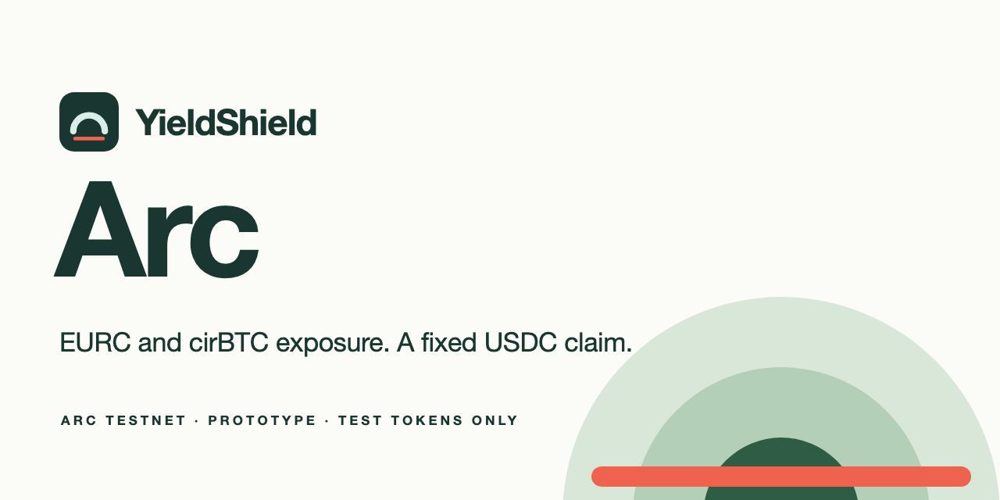

# YieldShield Arc

USDC-backed split-risk markets on Circle's Arc testnet. A holder deposits Circle EURC or cirBTC in exchange for a fixed USDC entry claim, which separately funded capital providers reserve at 150%. Providers earn a share of realized gains, and every reserve, exit and fee is enforced on chain. AI agents can read the markets through a static manifest and prepare unsigned transactions for a person's own wallet.

**Planned site:** https://arc.yieldshield.ai (not yet deployed; see [hosting](docs/HOSTING.md)). **License:** [MIT](LICENSE).

> Arc testnet only and unaudited. Testnet USDC, EURC and cirBTC come from Circle's faucet and have no monetary value. Do not use this code with real funds.

## Status — 19 October 2026

**Contracts are built, tested and rehearsed, and the deployment is waiting for testnet USDC.** The manifest state is `awaiting-testnet-usdc`, and the website keeps writes disabled until a verified deployment exists.

- **Deployer:** `0x10D42586A65a98BCa4baFAa1bF5DCB10c820f50a`, a new dedicated test signer.
  - **Funding:** it needs one claim of 20 USDC from https://faucet.circle.com (network: Arc Testnet).
  - **Why it is unfunded:** the faucet uses reCAPTCHA, so automation did not request funds.
- **Oracle feeds:** deployment also needs the Chronicle feeds on Arc testnet to be fresh. They had not updated since 18 October 09:08 UTC when checked ([preflight evidence](docs/evidence/arc-testnet-preflight.json)).

Evidence so far:

- **Full rehearsal:** the real `deploy-arc-testnet.mjs` and `verify-arc-testnet.mjs` were run against an Anvil using Arc's chain ID 5042002 and its 20 gwei base fee, with stand-ins at the canonical Arc addresses. Result: 8 transactions, verified, and a rerun sent nothing. A second wallet then completed the 8-transaction journey script ([evidence](docs/evidence/arc-rehearsal.json)).
- **Real Chronicle feeds, on a fork:** on a local fork of Arc testnet, the price adapter whitelisted itself through Chronicle's real SelfKisser. It read 1.123482 USDC per EURC and 81,827.183708 USDC per cirBTC, and correctly rejected both as stale under the 3-hour limit ([evidence](docs/evidence/chronicle-fork-check.json)).
- **Local journey:** 56 transactions on chain 31337, plus 6 browser-signed local transactions ([evidence](docs/evidence/local-journey.json), [browser receipts](docs/evidence/e2e/browser-receipts.json)).
- **Tests:** 60 Solidity tests (5 fuzz), 19 JavaScript tests and 12 browser tests pass.

Local and rehearsal results are not Arc testnet activity. No users, revenue, TVL, audit, partnership or mainnet readiness is claimed.

| Token | Role | Decimals | Address (Arc testnet) |
|---|---|---:|---|
| USDC | Provider backing, holder claims and gas | 6 (ERC-20 view; 18 native) | `0x3600000000000000000000000000000000000000` |
| EURC | Protected asset (EUR exposure against USDC) | 6 | `0x89B50855Aa3bE2F677cD6303Cec089B5F319D72a` |
| cirBTC | Protected asset (BTC exposure against USDC) | 8 | `0xf0C4a4CE82A5746AbAAd9425360Ab04fbBA432BF` |

| Market | Price source | Notes |
|---|---|---|
| EURC reference | Chronicle EURC/USD ÷ USDC/USD | Values older than 3 hours are rejected |
| cirBTC reference | Chronicle CIRBTC/USDC | Values older than 3 hours are rejected |
| EURC scenario lab | Synthetic 1.10 → 1.20 → 1.00 USDC cycle, changing every 120 s | Labelled synthetic everywhere; never a fallback |

## How it works

- **Protect.** Deposit EURC or cirBTC. The entry claim is `amount × price ÷ 10^decimals` USDC, fixed at entry. It is admitted only while providers' USDC covers 150% of all open claims.
- **Exit.** After a 60-second delay, choose either exit, for all or part of the position:
  - keep the asset, paying 12% of any realized gain: 10% to providers, 1% to the market creator and 1% to the protocol;
  - surrender the asset for its fixed USDC claim.
- **Mature.** Each epoch lasts at most 30 days. After maturity, anyone can settle the remaining positions: each owner gets a segregated USDC credit to claim, and providers take the asset.
- **Provide.** Deposit USDC for provider shares. Deposits and redemptions are frozen while any protection is open, which prevents providers from redeeming at a NAV that hides an unrealized shortfall. Redemption needs a 120-second notice and returns a basket of USDC and surrendered assets. Gain fees are claimed separately.
- **Stale prices fail closed.**
  - **Revert while stale:** new protection, asset exits and market creation.
  - **Keep working:** backing exits and settlement, which need no price.

**Arc specifics.** USDC is Arc's gas token. Its native balance (18 decimals) and its ERC-20 interface (6 decimals) are one balance. The contracts use only the ERC-20 interface and their own counters; nothing is payable. The interface keeps 0.1 USDC unspent for fees. USDC payouts are either the caller's own exit or a pull claim, so a blocklisted address cannot block anyone else's settlement. See [research and scope](docs/RESEARCH_AND_SCOPE.md).

## For agents

`/agent.json`, `/llms.txt` and `/abi/*.json` are generated at build time from `config/deployment.json`. They describe:

- the network, assets, markets and terms;
- oracle freshness rules;
- the safety checks to run before any transaction;
- recipes for unsigned transactions (protect, both exits, settlement, provide, redeem, claim).

Agents never sign, hold keys or send native value. The funded next step is to expose these as YieldShield MCP tools; see the [application draft](docs/grants/CIRCLE_DEVELOPER_GRANT_2026-10-19.md).

## Run and verify

Requirements: Node.js 22+ and [Foundry](https://getfoundry.sh).

```sh
npm ci --ignore-scripts
npm run dev                  # http://127.0.0.1:5201, reading config/deployment.json
npm run build                # static output in dist/, including agent.json and llms.txt
npm test                     # JavaScript unit tests
npm run test:contracts       # Solidity tests, including fuzz cases
npm run test:browser         # public routes, mobile, wallet, agent files
npm run rehearse:arc-testnet # full deploy + verify + journey on a chain-5042002 Anvil (port 8567)
npm run check:chronicle-fork # adapter against the real Arc testnet Chronicle feeds, on a local fork
```

Local transactions only:

```sh
anvil --host 127.0.0.1 --port 8567 --silent
node scripts/local-journey.mjs --browser-ready
node scripts/local-web.mjs   # local-chain preview at 127.0.0.1:5204
SHIELD_LOCAL_E2E=1 npm run test:browser -- tests/browser/local-lifecycle.spec.ts
```

Deploying (`npm run deploy:arc-testnet`, a read-only preflight until `--broadcast`), verification (`npm run verify:arc-testnet`) and the second-wallet journey (`npm run journey:arc-testnet`) are described in [operations](docs/OPERATIONS.md). They need dedicated test wallets in the ignored `.secrets/` directory. Never use a key that holds real funds.

Further reading:

- [operations](docs/OPERATIONS.md)
- [security](docs/SECURITY.md)
- [end-to-end evidence](docs/E2E_REPORT.md)
- [feature parity](docs/FEATURE_PARITY.md)
- [hosting](docs/HOSTING.md)
- [provenance](docs/PROVENANCE.md)

## Contributing and security

Issues and pull requests are welcome. Before proposing changes, run `npm test`, `npm run test:contracts` and `npm run build`. Report suspected vulnerabilities privately, as described in [SECURITY](docs/SECURITY.md), not in public issues.

## License

[MIT](LICENSE), copyright Hawig Ventures UG (haftungsbeschränkt), which develops YieldShield. Derived from the MIT `yieldshield-avalanche` template by the same owner ([provenance](docs/PROVENANCE.md)). OpenZeppelin, React, React Router, viem and Vite keep their upstream licenses.
